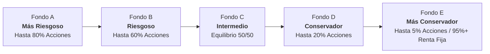
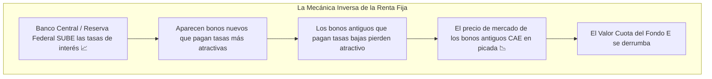
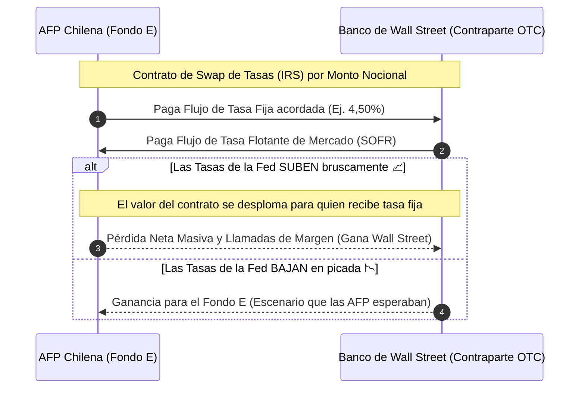
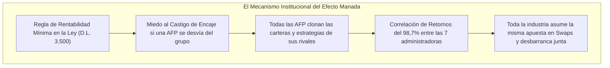

  

    

      🏛️ Documento Pedagógico Complementario
    

    

      Estás leyendo la guía didáctica y conceptual. Si deseas consultar la auditoría cuantitativa completa con los microdatos, fórmulas y formulación de cargos de la Superintendencia de Pensiones:
    

  

  

    <a href="/articulos/la-falacia-del-fondo-seguro-desplome-fondo-e/" class="btn btn-primary btn-sm">
      <svg width="16" height="16" viewBox="0 0 24 24" fill="none" stroke="currentColor" stroke-width="2"><line x1="5" y1="12" x2="19" y2="12"></line><polyline points="12 5 19 12 12 19"></polyline></svg>
      Ir a la Investigación Principal ➔
    </a>
    <a href="https://github.com/surzua/fondo-e-forensics" target="_blank" rel="noopener noreferrer" class="btn btn-secondary btn-sm">
      GitHub: fondo-e-forensics
    </a>
  

> ### 🧭 Propósito de esta Guía
> Si abriste los diarios económicos este mes, probablemente te encontraste con titulares cargados de tecnicismos intimidantes: *"Swaps de tasas"*, *"duración sintética fuera de balance"*, *"nocionales multimillonarios"*, *"short en dólares al 150%"* o *"cargos de la Superintendencia de Pensiones por infracción fiduciaria"*.
> 
> Durante décadas, el mundo financiero ha utilizado un lenguaje deliberadamente hermético que aleja a los ciudadanos de las decisiones que afectan directamente el fruto de 40 años de trabajo.
> 
> Esta guía fue diseñada con un objetivo simple: **explicar con absoluta claridad, rigor y metáforas de la vida cotidiana todos y cada uno de los conceptos financieros necesarios para comprender la crisis del Fondo E**. No necesitas saber matemáticas complejas ni tener formación en economía. Si sabes cómo funciona un crédito, un seguro de auto o un balancín de plaza, tienes todo lo necesario para entender lo que ocurrió.

---

## Índice Temático

1. [El Tablero de Juego: Multifondos y Ciclo de Vida](#módulo-1-el-tablero-de-juego-multifondos-y-ciclo-de-vida)
2. [El Dinero no Duerme en una Billetera: Cuotas, Inflación y UF](#módulo-2-el-dinero-no-duerme-en-una-billetera-cuotas-inflación-y-uf)
3. [La Paradoja de la Renta Fija: ¿Por qué un Bono Seguro puede Perder Dinero?](#módulo-3-la-paradoja-de-la-renta-fija-por-qué-un-bono-seguro-puede-perder-dinero)
4. [La Caña de Pescar vs. El Garrote: El Secreto de la "Duración"](#módulo-4-la-caña-de-pescar-vs-el-garrote-el-secreto-de-la-duración)
5. [Derivados y Swaps: Apostar al Clima sin Comprar el Campo](#módulo-5-derivados-y-swaps-apostar-al-clima-sin-comprar-el-campo)
6. [El Dólar al Revés: Un Seguro que te Cobra Doble si Chocas](#módulo-6-el-dólar-al-revés-un-seguro-que-te-cobra-doble-si-chocas)
7. [El Efecto Manada y el Encaje: ¿Por qué Todas las AFP Chocaron Juntas?](#módulo-7-el-efecto-manada-y-el-encaje-por-qué-todas-las-afp-chocaron-juntas)
8. [Cisnes Negros en Laboratorio: El Value at Risk (VaR) y las Colas Pesadas](#módulo-8-cisnes-negros-en-laboratorio-el-value-at-risk-var-y-las-colas-pesadas)
9. [El Daño Irreversible de Don Juan: Rentas Vitalicias y el Mito de "Esperar 5 Años"](#módulo-9-el-daño-irreversible-de-don-juan-rentas-vitalicias-y-el-mito-de-esperar-5-años)
10. [Tabla Resumen: Diccionario Rápido de Conceptos](#módulo-10-tabla-resumen-diccionario-rápido-de-conceptos)

---

## Módulo 1: El Tablero de Juego: Multifondos y Ciclo de Vida

Para entender por qué el desplome del Fondo E generó una crisis institucional y una formulación de cargos histórica, primero debemos entender la promesa fundacional de los multifondos.

### 1.1. Los 5 Multifondos (del A al E)

En 2002, Chile creó el esquema de multifondos, dividiendo los ahorros en cinco canastas identificadas de la A a la E según su nivel de riesgo y rentabilidad esperada:

* **Fondo A (El Velero en Alta Mar):** Invierte mayoritariamente en **acciones** (partes de empresas en Chile y el mundo). Cuando la economía global crece, vuela alto; pero cuando hay tormenta o crisis bursátil, puede caer con fuerza.
* **Fondo E (El Búnker de Concreto):** Invierte prácticamente todo su patrimonio en **títulos de deuda (bonos de renta fija)**. Por ley y diseño institucional, fue concebido como un refugio blindado contra la volatilidad. Su misión no es duplicar tu dinero de la noche a la mañana, sino **preservar el capital acumulado durante toda una vida**.

---

### 1.2. Acumulación vs. Desacumulación: El Factor Tiempo

La variable más importante en finanzas personales no es la tasa de interés ni el dólar: es **cuánto tiempo te queda antes de necesitar tu dinero**.

<table style="width:100%; border-collapse:collapse; font-size:0.9rem;">
  <thead>
    <tr style="background: rgba(56,189,248,0.15);">
      <th style="padding:10px 14px; text-align:left; border-bottom:2px solid var(--accent-cyan);">Factor</th>
      <th style="padding:10px 14px; text-align:center; border-bottom:2px solid var(--accent-cyan);">🟢 Juventud (20–45 años)</th>
      <th style="padding:10px 14px; text-align:center; border-bottom:2px solid var(--accent-red);">🔴 Pre-Jubilación (60–65 años)</th>
    </tr>
  </thead>
  <tbody>
    <tr>
      <td style="padding:9px 14px; border-bottom:1px solid var(--border-subtle);"><strong>Objetivo Previsional</strong></td>
      <td style="padding:9px 14px; border-bottom:1px solid var(--border-subtle); text-align:center;">Acumulación</td>
      <td style="padding:9px 14px; border-bottom:1px solid var(--border-subtle); text-align:center;">Desacumulación</td>
    </tr>
    <tr style="background: rgba(255,255,255,0.03);">
      <td style="padding:9px 14px; border-bottom:1px solid var(--border-subtle);"><strong>Vehículo Recomendado</strong></td>
      <td style="padding:9px 14px; border-bottom:1px solid var(--border-subtle); text-align:center;">Fondos A / B</td>
      <td style="padding:9px 14px; border-bottom:1px solid var(--border-subtle); text-align:center;">Fondos D / E</td>
    </tr>
    <tr>
      <td style="padding:9px 14px;"><strong>Margen de Espera</strong></td>
      <td style="padding:9px 14px; text-align:center; color: var(--accent-cyan);">20–40 años para recuperarse</td>
      <td style="padding:9px 14px; text-align:center; color: var(--accent-red); font-weight:700;">0–24 meses ⚠️ ¡Tiempo Agotado!</td>
    </tr>
  </tbody>
</table>

* **Etapa de Acumulación (25 a 45 años):** Si una crisis internacional hace caer tu fondo un -15%, no es agradable, pero tienes dos o tres décadas por delante para que la economía se recupere, crezca y supere los récords anteriores. Puedes asumir riesgo porque tienes tiempo.
* **Etapa de Desacumulación (60 a 65 años):** Estás a meses de jubilarte. Tu fondo ya no está creciendo con sueldos futuros; es el pozo definitivo con el que vas a financiar tus últimos 20 o 25 años de vida. **Aquí el riesgo debe ser mínimo**, porque si tu fondo se desploma justo antes de firmar la pensión, no tienes 10 años para esperar un rebote: la pérdida se hace definitiva en el acto.

  
⚖️ La Promesa de la Ley

  
Por mandato del <strong>Decreto Ley 3.500</strong>, los hombres mayores de 55 años y las mujeres mayores de 50 no pueden estar por defecto en el Fondo A. La ley los empuja deliberadamente hacia los fondos conservadores (D y E) bajo la promesa de que allí sus fondos estarán a salvo.

---

## Módulo 2: El Dinero no Duerme en una Billetera: Cuotas, Inflación y UF

Muchas personas creen erróneamente que en su cuenta individual de la AFP hay una pila de billetes en pesos chilenos guardados en una bóveda bancaria. La realidad es muy distinta.

### 2.1. El Valor Cuota: Los Ladrillos de un Fondo Común

Cuando cotizas el 10% de tu sueldo cada mes, la AFP no guarda billetes: **compra "cuotas" de un fondo de inversión**.

* 🧱 **La analogía del edificio:** Imagina que el Fondo E es un gran edificio de departamentos valorado en miles de millones de pesos, y ese edificio está dividido en millones de ladrillos idénticos llamados **cuotas**.
* Tu cartola previsional no dice realmente "tienes \$100.000.000 de pesos". Lo que dice es: *"Eres dueño de 2.000 ladrillos (cuotas), y cada ladrillo hoy vale \$50.000 pesos"*.
* **¿Por qué varía tu saldo?** Todos los días hábiles a las 18:00 hrs, la Superintendencia de Pensiones calcula cuánto valen en el mercado todas las inversiones del edificio (los bonos, los depósitos, etc.) y divide ese valor total por el número de cuotas. Ese resultado es el **Valor Cuota**.
  * Si los activos del fondo pierden valor, cada cuota pasa de valer \$50.000 a \$45.000.
  * Sigues teniendo exactamente los mismos 2.000 ladrillos, pero tu patrimonio ahora es de solo \$90.000.000.

---

### 2.2. Retorno Nominal vs. Retorno Real (Efecto UF e Inflación)

En economía existen dos maneras de medir las ganancias o pérdidas:

1. **Retorno Nominal (En Pesos Chilenos corrientes):** La cantidad bruta de monedas y billetes. Si empezaste con \$100 y terminas con \$103, ganaste \$3 nominales (+3%).
2. **Retorno Real (Poder Adquisitivo medido en UF o Canastas de Supermercado):** Lo que realmente puedes comprar con ese dinero.

* 🛒 **La analogía del carro de supermercado:**  
  Imagina que en enero metes \$100.000 a una alcancía con los que puedes comprar exactamente 100 kilos de pan. En diciembre abres la alcancía y tienes \$103.000 (ganaste +3% nominal). Pero vas a la panadería y el kilo de pan ahora cuesta \$1.070 debido a la inflación (+7%). Aunque tienes más billetes en la mano, ahora solo puedes comprar 96 kilos de pan. **En términos reales, te empobreciste un 4%.**

* **En el caso del Fondo E en 2026:**
  * En términos **nominales**, el fondo cayó un **-7,40%**.
  * Pero como la inflación (medida por la UF) subió un **+3,34%**, el golpe al bolsillo real de los afiliados fue de un devastador **-10,39% real**.

---

## Módulo 3: La Paradoja de la Renta Fija: ¿Por qué un Bono Seguro puede Perder Dinero?

Este es el concepto donde tropieza el 90% de los ciudadanos. Si se llama "renta fija", ¿por qué no rinde un porcentaje fijo y asegurado?

### 3.1. ¿Qué es un Bono?

Un bono no es una acción de una empresa que cotiza en bolsa. **Un bono es un pagaré oficial de deuda.**

Cuando el Estado de Chile (la Tesorería General de la República) o una empresa de primera línea necesitan miles de millones para construir carreteras, hospitales o expandir operaciones, emiten bonos. 

Si el Fondo E compra un bono de la Tesorería por \$1.000.000 a 10 años que paga un cupón del 3% anual, el trato es:
1. El Estado le pagará al fondo \$30.000 cada año durante 10 años (los intereses o "cupones").
2. Al cumplirse los 10 años, el Estado le devolverá el \$1.000.000 completo original (el "principal").

Si el fondo conserva ese bono hasta el último día del año 10, jamás perderá dinero: cobrará religiosamente todos los intereses y el capital pactado. **Entonces, ¿dónde está el riesgo?**

---

### 3.2. La Ley del Balancín: La Relación Inversa entre Tasas de Interés y Precio de los Bonos

El riesgo surge porque los fondos de pensiones no guardan los bonos en un cajón cerrado con llave: **los valorizan diariamente al precio que tendrían si tuvieran que venderlos hoy en el mercado financiero**.

Y en ese mercado ocurre un fenómeno matemático inexorable: **el balancín financiero**.

  

    
📈

    
ALZA DE TASAS

    
Banco Central / Reserva Federal sube las tasas de interés en el mercado

  

  
⚖️

  

    
📉

    
CAÍDA DEL BONO

    
El precio de mercado de los bonos antiguos (que pagan tasas bajas) se derrumba

  

* 🚗 **La analogía del auto usado y la concesionaria:**
  * Imagina que compraste un auto nuevo que rinde **10 kilómetros por litro** de bencina.
  * Al día siguiente, la fábrica de autos anuncia una revolución tecnológica: todos los autos nuevos que salgan a la venta a partir de hoy rendirán **20 kilómetros por litro** al mismo precio.
  * Si decides vender tu auto usado esa misma tarde, ¿alguien te pagará lo que te costó? **Jamás.** Nadie querrá tu auto viejo a menos que le hagas un descuento sustantivo en el precio para compensar su menor rendimiento frente a los nuevos.

* **En el mercado de bonos pasa exactamente lo mismo:**
  * El Fondo E tenía bonos antiguos que pagaban una tasa de interés del **3%**.
  * De pronto, la inflación persiste en Estados Unidos y Chile, y los bancos centrales suben las tasas de interés al **5%**.
  * Todos los inversionistas del mundo exigen comprar bonos nuevos al 5%. Si el Fondo E quiere vender sus bonos antiguos al 3%, nadie se los comprará por \$1.000.000. **El precio de mercado de esos bonos cae a \$850.000 para que su rendimiento se iguale al 5% del mercado.**
  * Al calcular el valor cuota esa tarde, el Fondo E debe anotar una pérdida contable inmediata.

---

## Módulo 4: La Caña de Pescar vs. El Garrote: El Secreto de la "Duración"

Si la subida de tasas hace caer el precio de los bonos, la pregunta fundamental es: **¿cuánto cae?** ¿Cae un 1%, un 5% o un 20%?

La respuesta matemática a esa pregunta se llama **Duración**.

### 4.1. ¿Qué es la Duración en Finanzas?

En el lenguaje de la calle, "duración" suena a cuánto tiempo falta para que termine algo (por ejemplo, "la película dura dos horas"). 

En finanzas profesionales, la **duración modificada** es una medida de **sensibilidad o elasticidad**: mide cuántos puntos porcentuales sube o baja el precio de tu cartera ante un movimiento del 1% (100 puntos base) en las tasas de interés.

$$\text{Variación del Precio} \approx - \text{Duración} \times \text{Cambio en la Tasa de Interés}$$

* 🎣 **La analogía de la vara de madera vs. la caña de pescar:**
  * **Vara de roble corta (Duración de 2 a 5 años):** Imagina que sostienes con las manos un palo de madera maciza de medio metro de largo. Si alguien empuja levemente la punta, apenas se mueve. Es rígido, seguro y predecible.
  * **Caña de pescar ultra larga (Duración de 17 años):** Ahora imagina que sostienes una caña de pescar de fibra de vidrio de 17 metros de largo. La vara es tan larga y elástica que la más leve brisa en la punta se transmite a lo largo del material provocando oscilaciones gigantescas y descontroladas en tu mano.

---

### 4.2. Lo que Hicieron las AFP: Estirar la Caña de 5 a 17 Metros

Históricamente (2002–2020), el Fondo E chileno operaba con una duración prudente de **5,0 años**. 

* Si las tasas de interés mundiales subían un +1%, el Fondo E caía cerca de un **-5%**. Ese golpe era moderado y los cupones que cobraba mes a mes lo amortiguaban rápidamente.
* **El pecado de 2024–2026:** Buscando capturar rentabilidades más altas para lucirse en los rankings, las administradoras alargaron deliberadamente los plazos de sus inversiones. Compraron bonos de Tesorería a 20 o 30 años (duración física de 10,2 años) y luego, mediante contratos derivados, sumaron 6,8 años más de duración sintética.
* **El resultado:** Llevaron la duración agregada del Fondo E a **17,0 años**.

  
⚠️ El Cálculo Fatal

  
Cuando las tasas del Bono del Tesoro de EE.UU. a 10 años subieron <strong>+1,11%</strong> (de 4,18% a 5,29%), el impacto matemático sobre una caña de pescar de 17 años no fue de un manejable -5%:

  
$$\text{Caída Teórica} \approx -17{,}0 \times (+1{,}11\%) = \mathbf{-18{,}87\%}$$

  
Las AFP convirtieron el búnker de los jubilados en una montaña rusa de alta velocidad.

---

## Módulo 5: Derivados y Swaps: Apostar al Clima sin Comprar el Campo

Llegamos al corazón de la auditoría forense: **el 79,7% de la pérdida del Fondo E no vino de los bonos físicos chilenos, sino de contratos de derivados financieros offshore.**

¿Qué son estos instrumentos que suenan a ciencia ficción para el ciudadano común?

### 5.1. ¿Qué es un Derivado Financiero?

Un derivado es un contrato financiero cuyo valor **se deriva** del precio de otro activo subyacente (como el trigo, el oro, el dólar o las tasas de interés).

* 🌾 **La analogía de la cosecha de trigo:**
  * Si quieres invertir en trigo, la forma tradicional es comprar un saco de granos, guardarlo en una bodega y esperar a que suba de precio. Tienes el trigo físico.
  * Un **derivado**, en cambio, es una apuesta contractual entre dos personas: *"Si en diciembre llueve y la tonelada de trigo sube a \$200, tú me pagas la diferencia; si no llueve y cae a \$100, yo te pago a ti"*.
  * Para firmar ese papel **no necesitas ser dueño de un campo ni tener un solo grano de trigo**. Solo necesitas firmar un contrato sobre el precio futuro.

---

### 5.2. Mercados Bursátiles vs. Mercados Extrabursátiles (OTC: Over-the-Counter)

Existen dos lugares en el mundo donde se transan instrumentos financieros:

1. **La Bolsa Regulada (Bursátil):** Como la Bolsa de Santiago o la Bolsa de Nueva York (NYSE). Es como un supermercado formal: los precios están en una pantalla transparente, las condiciones están estandarizadas, hay un cajero central que garantiza que nadie haga trampa y todo queda registrado al segundo.
2. **El Mercado OTC (Over-the-Counter o "Fuera de Bolsa"):** Son tratos directos, privados y a medida acordados por teléfono o terminales Bloomberg entre dos instituciones (por ejemplo, una AFP chilena y un banco de inversión en Wall Street como JP Morgan o Goldman Sachs). No hay vitrina pública abierta ni supervisión en tiempo real de los afiliados.

---

### 5.3. ¿Qué es un Swap de Tasas de Interés (Interest Rate Swap - IRS)?

Un *Swap* (palabra en inglés que significa "intercambio") es un contrato OTC donde dos partes acuerdan **intercambiarse mutuamente flujos de intereses periódicos** durante varios años.

* 🤝 **La analogía del dividendo hipotecario:**
  * Imagina que tienes un amigo que tiene un crédito hipotecario con **tasa fija** (paga religiosamente \$500.000 al mes, pase lo que pase).
  * Tú tienes un crédito con **tasa variable** (a veces pagas \$300.000 si las tasas bajan, pero si suben te cobran \$800.000).
  * Un día se juntan a almorzar y deciden hacer un Swap: pactan que tú le pagarás su cuota fija de \$500.000 y él pagará tu cuota variable.
  * Si las tasas de mercado se desploman al 1%, tú ganas la apuesta, porque le pagas poco al banco y recibes una suma fija garantizada.
  * **Pero si las tasas se disparan al 8%, la cuota variable explota y tú quedas en la ruina pagando una fortuna cada mes.**

---

### 5.4. El Truco del "Nocional": Apalancamiento sin Poner Dinero de Entrada

Aquí reside el vacío regulatorio que aprovecharon las AFP:

* Si una AFP quiere comprar **US$ 1.000 millones** en bonos físicos de EE.UU., tiene que sacar US$ 1.000 millones de la cuenta corriente del Fondo E y transferirlos. Ese dinero queda registrado de inmediato en el balance y cuenta contra los límites estrictos que fija la ley.
* Pero un Swap de Tasas **no requiere pagar el capital al inicio**. Solo se intercambian las diferencias de intereses. El monto sobre el cual se calculan esos intereses se llama **Monto Nocional** (es un valor teórico de referencia).
* Como al firmar el contrato el desembolso de caja es prácticamente cero, las AFP pudieron acumular posiciones monstruosas **fuera de balance**. El nocional en derivados de tasas del sistema de pensiones saltó de **US$ 5.300 millones en 2023** a la increíble cifra de **US$ 206.900 millones a fines de 2025**.

  
🚨 El Desenlace

  
Las AFP apostaron masivamente a que la Reserva Federal de EE.UU. recortaría agresivamente las tasas de interés. Pero la inflación estadounidense no cedió, las tasas no bajaron y los contratos de Swaps generaron pérdidas multimillonarias que las administradoras tuvieron que pagar <strong>liquidando el valor de las cuotas del Fondo E</strong>.

---

## Módulo 6: El Dólar al Revés: Un Seguro que te Cobra Doble si Chocas

Si el golpe de los swaps fue severo, las administradoras cometieron un segundo error técnico que desarmó la principal protección natural que tienen los ahorros en Chile.

### 6.1. El Dólar como Colchón Natural (Flight to Quality)

En Chile, el tipo de cambio cumple una función protectora clave en las crisis:
* Cuando estalla una guerra, una pandemia o una crisis de tasas en Wall Street, los inversionistas globales huyen de los mercados emergentes y se refugian en la moneda más fuerte del planeta: el dólar estadounidense.
* Esto hace que el dólar en Chile se dispare hacia arriba (el peso chileno se devalúa).
* Para un fondo de pensiones que tiene activos en el extranjero, esto suele ser una bendición: aunque las acciones o bonos extranjeros caigan en Nueva York, al multiplicar su valor por un dólar más alto en pesos chilenos, **la ganancia cambiaria absorbe el golpe y amortigua la caída**.

---

### 6.2. ¿Qué es un Contrato Forward de Moneda?

Un *Forward* es un contrato derivado donde dos partes fijan hoy el precio al que se comprarán o venderán dólares en una fecha futura (por ejemplo, en 6 meses más), sin importar lo que marque la cotización en la calle ese día.
* Si tienes US\$ 100 en el exterior y vendes un forward a \$900 CLP, te aseguras de recibir \$90.000 pesos chilenos pase lo que pase con el dólar. Eso se llama **cobertura cambiaria (Hedging)**.

---

### 6.3. La Posición Corta ("Short") y la Sobrecobertura al 150%

Una cobertura prudente y conservadora consiste en cubrir el **100%** de los activos extranjeros: tienes 100 dólares afuera, aseguras 100 dólares. Ni ganas ni pierdes por tipo de cambio.

**¿Qué hicieron las AFP en el Fondo E?**
* Cubrieron el equivalente al **150%** de sus activos extranjeros.
* Es decir, por cada 100 dólares reales que tenían invertidos fuera de Chile, vendieron contratos forward por **150 dólares**.
* Al hacer esto, **dejaron de estar cubiertas y pasaron a estar "cortas" (Short USD en un 50%)**. En la práctica, ejecutaron una apuesta especulativa a que el peso chileno se fortalecería y el dólar se derrumbaría.

* 🚗 **La analogía del seguro de auto autodestructivo:**
  * Tienes un auto valorado en \$10 millones. Contratas un seguro normal de \$10 millones para estar tranquilo.
  * Pero además firmas un contrato con un vecino donde le apuestas \$5 millones a que tu auto jamás va a chocar.
  * Si chocas, el seguro te paga los \$10 millones del auto, pero pierdes la apuesta con tu vecino y tienes que pagarle \$5 millones de tu bolsillo. Terminaste perdiendo plata en el choque a pesar de tener seguro.

* **El resultado en 2026:** El dólar en Chile no cayó: subió con fuerza de **\$911 a \$970 CLP**. En lugar de operar como amortiguador, la sobrecobertura corta provocó pérdidas directas por **-0,80 puntos porcentuales (-US\$ 750 millones)** que se sumaron a la sangría de los swaps.

---

## Módulo 7: El Efecto Manada y el Encaje: ¿Por qué Todas las AFP Chocaron Juntas?

Una de las preguntas más legítimas que se hace cualquier ciudadano es: *¿Cómo es posible que las siete AFP del país (Capital, Cuprum, Habitat, Modelo, Planvital, Provida y UNO) hayan cometido exactamente las mismas operaciones de riesgo al mismo tiempo?*

La respuesta no es una conspiración secreta en una sala oscura: es **un incentivo perverso grabado en la propia ley de pensiones**.

### 7.1. ¿Qué es el "Encaje"?

Para evitar que los dueños de las AFP jueguen a la ruleta con los ahorros ajenos sin arriesgar nada propio, el Decreto Ley 3.500 les exige poner sobre la mesa una garantía obligatoria: el **Encaje**.
* Cada AFP debe invertir el equivalente al **1% de todos los fondos administrados** utilizando su propio patrimonio corporativo.
* La plata del encaje se invierte en los mismos multifondos que los afiliados. Si el fondo gana, los dueños de la AFP ganan; si el fondo pierde, los dueños pierden dinero propio.

---

### 7.2. La Regla de Rentabilidad Mínima: La Trampa de la Manada (Herding)

Para proteger a los trabajadores, la ley establece una regla de **Rentabilidad Mínima**:
* Ninguna AFP puede rendir significativamente menos que el promedio de toda la industria en un periodo móvil de 36 meses.
* Si una administradora se queda por debajo de esa banda mínima, **la ley la obliga a sacar dinero de su propio bolsillo (su encaje patrimonial) para pagarle la diferencia a los afiliados**. Y si su encaje se agota, el Estado le quita la licencia y la liquida.

* 🚌 **La analogía del convoy de buses en la neblina:**
  * Imagina una flota de siete buses que transporta pasajeros por un camino de montaña lleno de niebla.
  * La regla de la empresa de transporte dice: *"Ningún chofer puede llegar más de 5 minutos después que los demás. Si un chofer llega atrasado porque manejó lento y precavido, se le descontará todo su sueldo del mes"*.
  * El chofer más agresivo decide acelerar a 130 km/h por el borde del precipicio.
  * ¿Qué hacen los otros seis choferes? Aunque saben que es una locura temeraria, **están obligados a acelerar a 130 km/h pegados al primero**. Si bajan la velocidad para ser prudentes y los otros logran pasar, perderán su sueldo.
  * Pero si todos aceleran juntos y todos desbarrancan en la misma curva... **nadie rinde menos que el promedio y ningún chofer tiene que pagar multas de su bolsillo**.

Esta dinámica de rebaño explica por qué la **correlación estadística entre las 7 AFP alcanzó un escalofriante 0,987 (98,7%) en 2026**: todas compraron los mismos derivados, en los mismos bancos de Nueva York y con los mismos plazos.

---

## Módulo 8: Cisnes Negros en Laboratorio: El Value at Risk (VaR) y las Colas Pesadas

En el informe técnico y en los descargos de la Asociación de AFP se menciona constantemente el término **Value at Risk (VaR)** para argumentar si este descalabro era "un riesgo previsible" o "un rayo imprevisto en un día soleado".

### 8.1. ¿Qué es el Value at Risk (VaR)?

El *Valor en Riesgo* es el estándar dorado de la gestión de riesgos en la banca global. Responde a una pregunta muy concreta: **¿cuánto es lo máximo que espero perder en mi cartera en un mes determinado, con un 95% o 99% de confianza estadística?**

* ☔ **La analogía del dique de contención:**
  * Los ingenieros que construyen un dique contra inundaciones en una ciudad calculan la lluvia máxima de los últimos 100 años (un evento que ocurre solo el 1% de las veces). Con esa base, diseñan el muro de contención.
  * Un **VaR al 99%** dice: *"Bajo condiciones normales de mercado, en 99 de cada 100 meses nuestra pérdida no superará el -3%. Solo 1 vez cada 100 meses (una vez cada 8 años) podríamos ver una pérdida mayor"*.

---

### 8.2. Colas Pesadas (Fat Tails) y Modelos Ciegos

La estadística tradicional asume que los retornos financieros siguen una **Campana de Gauss (distribución normal)**, donde los eventos extremos (como que caiga un meteorito financiero) son prácticamente imposibles.

  

    
📊

    
Distribución Normal <small style="font-weight:400; color:var(--text-muted);">(Modelo Teórico)</small>

    
Eventos extremos con probabilidad &lt; 0,01% — considerados prácticamente imposibles

  

  
≠

  

    
🦢

    
Colas Pesadas (Fat Tails) <small style="font-weight:400; color:var(--text-muted);">(Realidad con Derivados)</small>

    
Eventos extremos ocurren con alta frecuencia — el modelo subestima catástrofes

  

* **El hallazgo forense:** Cuando una cartera se llena de derivados sintéticos apalancados y sobrecoberturas cambiarias, la distribución estadística se deforma. La campana se rompe y aparecen las llamadas **colas pesadas (*fat tails*)**.
* Los eventos que supuestamente solo debían ocurrir una vez cada siglo comenzaron a ocurrir mes por medio durante 2026. La Asociación de AFP argumentó que se trató de un shock externo imprevisible; la auditoría matemática demuestra que **las administradoras fabricaron las colas pesadas al alterar artificialmente la física del fondo**.

---

## Módulo 9: El Daño Irreversible de Don Juan: Rentas Vitalicias y el Mito de "Esperar 5 Años"

Llegamos al punto donde la teoría financiera choca con la vida real de las personas.

La defensa pública más repetida por el gremio de las AFP ante la Comisión de Trabajo del Congreso y en entrevistas de prensa fue la siguiente:  
> *"En el sistema de pensiones no hay pérdidas definitivas, sino alzas y bajas en la valorización contable que históricamente se recuperan en el mediano y largo plazo. Los afiliados solo deben mantener la calma y esperar 3 a 5 años para que el ciclo rebote"*.

¿Es válida esta afirmación para alguien que está en el Fondo E? **No. Es una falacia matemática y actuarial absoluta.**

---

### 9.1. Las Dos Rutas de Jubilación: Retiro Programado vs. Renta Vitalicia

Cuando un trabajador chileno cumple la edad legal de retiro (60 años mujeres, 65 años hombres), debe elegir entre dos modalidades principales:

1. **Retiro Programado (Te quedas en la AFP):** Tu dinero sigue en la administradora y tú retiras una mensualidad calculada año a año. Si los fondos suben, tu pensión futura sube; si bajan, tu pensión baja. Asumes todo el riesgo financiero y de longevidad hasta que fallezcas.
2. **Renta Vitalicia (Traspaso a una Compañía de Seguros):** Tomas todo tu saldo acumulado en la AFP, emites un cheque único y definitivo y se lo transfieres a una compañía de seguros de vida privada. A cambio, la aseguradora firma un contrato legal donde se compromete a pagarte **una pensión mensual fija en UF de por vida**, hasta el último día en que respires, sin importar si vives hasta los 70 o los 105 años.

---

### 9.2. El Capital Necesario Unitario (CNU) y las Tablas de Mortalidad RV-2020

Para calcular cuánta pensión te paga la compañía de seguros por cada millón que le entregas, se utiliza una fórmula estricta regulada por la ley llamada **Capital Necesario Unitario (CNU)**:

$$\text{Pensión Mensual Vitalicia} = \frac{\text{Saldo Final Acumulado}}{12 \times \text{CNU}(x, \text{sexo}, i_t)}$$

* El **CNU** representa cuánto dinero en valor presente necesita la aseguradora para pagarte 1 peso de por vida a la edad $x$, tomando en cuenta las tablas oficiales de expectativas de vida (**RV-2020**) y la tasa de interés de descuento técnico ($i_t \approx 3,2\%$).
* Para un hombre de 65 años recién cumplidos, el CNU ronda aproximadamente los **12,5 años**.
* **La regla de oro:** Tu pensión mensual es directamente proporcional al saldo final que tengas en la cuenta el día exacto en que te jubilas.

---

### 9.3. La Foto Congelada: Por Qué la Pérdida se Vuelve de Hormigón Armado

Analicemos el caso real de **Don Juan**, 64 años y 9 meses, quien tenía planificado jubilarse en diciembre de 2026 tras 40 años de trabajo ininterrumpido:

* **Saldo en enero de 2026:** \$100.000.000 CLP.
  * Con ese saldo, el cálculo actuarial le otorgaba una pensión de **\$664.000 CLP mensuales de por vida**.
* **Saldo tras el desplome del Fondo E (septiembre 2026):** \$89.610.000 CLP (-10,39% real).
  * Con ese nuevo saldo, la aseguradora le ofrece una pensión de **\$595.000 CLP mensuales de por vida**.

  

    
Pensión Original Esperada

    
&#36;664.000

    
/ mes de por vida

  

  

    
Pensión Real Post-Shock

    
&#36;595.000

    
/ mes de por vida

  

  
Recortada Para Siempre

  
&#8722;&#36;69.000 / mes

  
Pérdida neta acumulada: <strong style="color:#ef4444;">&#8722;&#36;16,5 millones a 20 años</strong>

  
⚖️ La Trampa de la "Espera"

  
Cuando Don Juan firma el contrato de Renta Vitalicia, la administradora debe <strong>vender las cuotas en el mercado para transferir los \$89,6 millones a la aseguradora</strong>.

  
En ese milisegundo exacto, la "baja transitoria de valorización" <strong>se congela en una pérdida irreversible para siempre</strong>. Si en 2028 el Fondo E sube un +20%, Don Juan no verá un solo peso de ese rebote: sus cuotas ya fueron vendidas a precio de remate en 2026.

---

### 9.4. ¿Y si Don Juan Decide Esperar? El Resultado de la Simulación de Monte Carlo

Frente al consejo de las AFP de *"no se jubile todavía, trabaje un tiempo más y espere a que el ciclo se recupere"*, la auditoría cuantitativa ejecutó una simulación estocástica de **Monte Carlo con 10.000 trayectorias futuras** (considerando que sigue trabajando y aportando el 10% de su sueldo imponible todos los meses).

Los resultados derriban la promesa de recuperación rápida:

```mermaid
gantt
    title Meses Adicionales de Trabajo Necesarios para Recuperar el Saldo Previo
    dateFormat X
    axisFormat %s meses
    
    Escenario Optimista (Percentil 10)  :0, 11
    Mediana del Mercado (Percentil 50)  :0, 21
    Escenario Pesimista (Percentil 90)  :0, 38
```

1. **La Mediana (50% de probabilidad):** Don Juan necesita trabajar y cotizar religiosamente durante **21 meses adicionales (casi 2 años de trabajo forzado extra)** solo para volver a tener los \$100 millones que ya tenía a comienzos de año.
2. **La Probabilidad en 1 Año:** Existe un **78,4% de probabilidad** de que, tras esperar un año completo trabajando a los 65 años, Don Juan todavía tenga menos dinero que antes de la crisis.

Pedirle a un trabajador vulnerable de 64 años con problemas de salud o desempleo que *"espere al próximo ciclo"* no es una recomendación técnica prudente: es trasladarle el costo de una apuesta financiera fallida de la administradora.

---

## Módulo 10: Tabla Resumen: Diccionario Rápido de Conceptos

Guarda esta tabla para tener a mano el significado de cada término al momento de leer la investigación completa:

| Concepto Técnico | ¿Qué Cree la Mayoría? | ¿Qué Significa Realmente? | La Metáfora Cotidiana |
| :--- | :--- | :--- | :--- |
| **Fondo E** | Una cuenta de ahorro garantizada sin riesgo. | Un fondo de inversión en renta fija sujeto a oscilaciones de tasas de interés. | El búnker que debía protegerte del viento en la meta. |
| **Renta Fija** | Ganancia asegurada e inmutable. | Títulos de deuda cuyo precio sube o baja todos los días en el mercado libre. | El pagaré oficial del Estado o de una empresa. |
| **Ley del Balancín** | Que las tasas y los precios suben juntos. | Relación inversa: si las tasas de interés suben, el precio de los bonos antiguos cae. | El subibaja de los niños en la plaza de juegos. |
| **Duración Modificada** | Los años que faltan para que venza el bono. | La sensibilidad: cuánto cae el precio de la cartera si la tasa de interés sube un 1%. | La caña de pescar: mientras más larga, más oscila con el viento. |
| **Derivado Financiero** | Un producto complejo exclusivo de genios. | Un contrato que apuesta sobre el precio futuro de algo sin comprar el bien físico. | La apuesta sobre el clima sin ser dueño del campo de trigo. |
| **Swap de Tasas (IRS)** | Una compra de bonos extranjeros. | Un intercambio de flujos: pagar una tasa fija a cambio de recibir una tasa variable. | Intercambiar el dividendo de tu casa con el de un amigo. |
| **Monto Nocional** | El dinero en efectivo que se pagó. | La cifra teórica sobre la cual se calculan los intereses de un contrato. | El valor de la casa sobre la cual apuestas en una servilleta. |
| **Mercado OTC** | La bolsa pública de valores. | Tratos privados bilaterales acordados directamente entre bancos y administradoras. | Comprar algo por teléfono en privado sin vitrina pública. |
| **Short USD (Posición Corta)** | Tener muchos dólares guardados. | Apostar en contra del dólar: vender más dólares futuros de los que posees. | Un seguro de auto que te cobra una multa si tienes un choque. |
| **Encaje de la AFP** | Un impuesto fiscal. | El 1% de patrimonio propio que la AFP debe arriesgar junto a los afiliados. | La fianza que pone el chofer antes de manejar el bus. |
| **Efecto Manada (Herding)** | Una coincidencia casual. | La obligación de clonar a la competencia para no pagar multas de rentabilidad mínima. | Los buses que van pegados en la niebla para no llegar tarde. |
| **Value at Risk (VaR)** | Una garantía de no perder jamás. | La pérdida máxima esperada con un 95% o 99% de confianza estadística. | La altura del dique diseñada para la lluvia del siglo. |
| **Renta Vitalicia** | Seguir teniendo la plata en la AFP. | Vender todo el saldo a una aseguradora a cambio de una pensión mensual fija de por vida. | Un cheque único y definitivo a cambio de un sueldo eterno. |
| **Desacumulación** | Seguir ahorrando mes a mes. | La etapa final en que retiras y gastas el dinero; no hay tiempo para esperar rebotes. | Estar a 10 metros de cruzar la meta de una maratón de 42 km. |

---

## 🚀 Paso Siguiente: Entendiendo la Investigación Forense

Ahora que dominas la mecánica del balancín de bonos, el elástico de la duración de 17 años, las apuestas en contratos swaps y el dilema actuarial de Don Juan, estás 100% equipado para comprender cada detalle de la auditoría técnica.

  

    

      🔍 Pasa de los Conceptos a la Evidencia Empírica
    

    

      Revisa la auditoría completa con los microdatos oficiales de la Superintendencia de Pensiones, fórmulas de atribución y los cargos contra las administradoras.
    

  

  

    <a href="/articulos/la-falacia-del-fondo-seguro-desplome-fondo-e/" class="btn btn-primary btn-sm">
      <svg width="16" height="16" viewBox="0 0 24 24" fill="none" stroke="currentColor" stroke-width="2"><line x1="5" y1="12" x2="19" y2="12"></line><polyline points="12 5 19 12 12 19"></polyline></svg>
      Leer Investigación Completa ➔
    </a>
  

